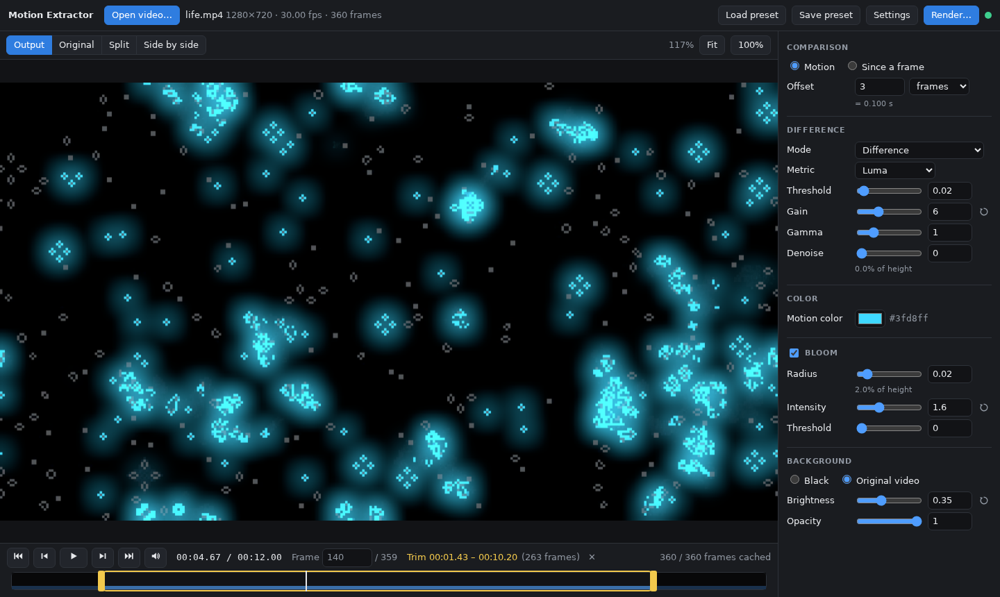

# Motion Extractor

Highlights the motion in a video by comparing each frame with an earlier one, based on Posy's
[Motion Extraction](https://youtu.be/NSS6yAMZF78) video.



## Run

Installers for Linux, Windows and macOS are attached to the GitHub releases; builds of the latest
`main` are in the rolling `nightly` pre-release. Linux packages need ffmpeg installed; the other
builds include it.

```sh
motion-extractor [video]                        # desktop app
motion-extractor serve --root ~/Videos          # web UI at http://127.0.0.1:8090/
motion-extractor render in.mp4 out.mp4 --offset 3f --color '#00ff88' --bloom
motion-extractor render --help                  # all options
```

## Build

Requires [mise](https://mise.jdx.dev), ffmpeg + ffprobe on `PATH`, and the
[Tauri prerequisites](https://tauri.app/start/prerequisites/) for the desktop app.

```sh
mise install              # Node.js, Rust, actionlint
mise run build            # target/release/motion-extractor
mise run serve            # web UI at http://127.0.0.1:8090/
mise run test             # tests (mise tasks lists everything)
```
